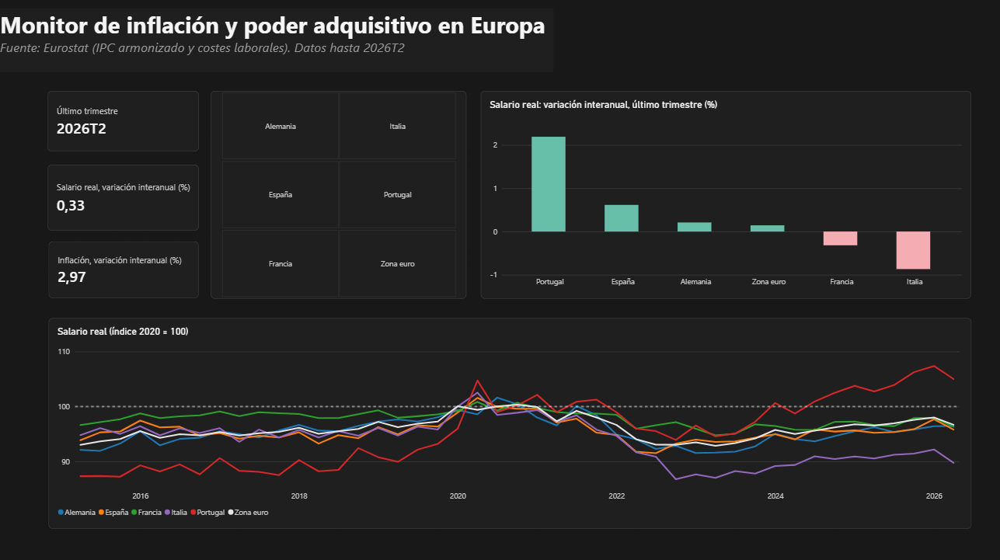
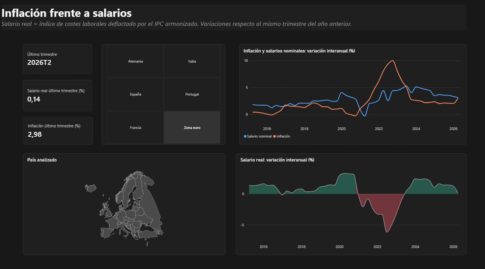
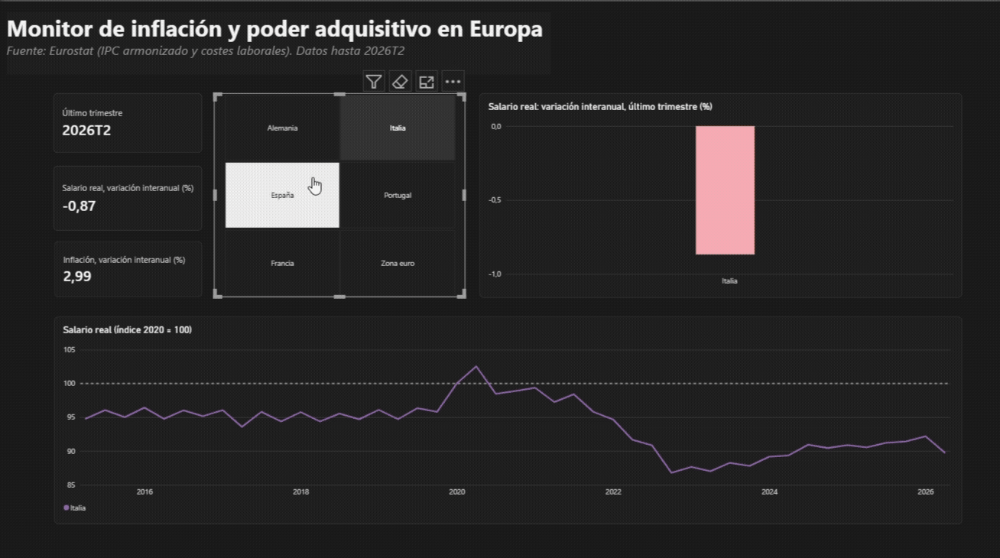
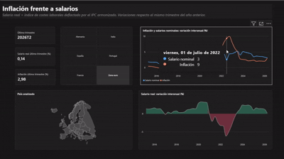

# European Inflation & Purchasing Power Monitor


Automated pipeline and dashboard comparing harmonised inflation (HICP) and wage growth in **Spain, Germany, France, Italy, Portugal and the euro area**, to see whether wages are keeping up with prices. Data comes from Eurostat and is refreshed every month with GitHub Actions.

## Dashboard preview

> Dashboard labels are in Spanish.




| Overview | Inflation vs. wages |
|---|---|
|  |  |

## Questions this project answers

- Have real wages recovered the purchasing power lost during the 2021–2023 inflation spike?
- Which countries are gaining or losing purchasing power right now?
- How strongly do nominal wages follow inflation in each country?

## Main findings

Latest quarter available (2026 Q2), year-on-year change in %:

| Country | Inflation | Nominal wages | Real wages |
|---|---|---|---|
| Portugal | 3.19 | 5.45 | **+2.19** |
| Spain | 3.58 | 4.22 | **+0.62** |
| Germany | 2.62 | 2.84 | **+0.21** |
| Euro area | 2.98 | 3.12 | **+0.14** |
| France | 2.43 | 2.10 | **-0.32** |
| Italy | 2.99 | 2.09 | **-0.87** |

- **2022 was a shock for everyone:** real wages fell sharply in all six economies as inflation outpaced wage growth.
- **Long-run trend (log-linear regression on real wages):** Germany shows the clearest gain (about +0.5% per year, highly significant). France (+0.26%) and Spain (+0.19%) also grow, but more weakly. For Italy and Portugal there is no statistically significant trend over the full sample.
- **Pass-through from inflation to nominal wages is partial everywhere:** the estimated coefficient is below 1 in every country (euro area ≈ 0.48, France ≈ 0.42, Germany and Spain ≈ 0.23). For Italy and Portugal it is not distinguishable from zero.

These figures are descriptive, not causal (see Limitations).

## Tech stack

- **Python:** pandas, requests, `eurostat`, statsmodels, matplotlib
- **SQL:** SQLite for storage and queries
- **Power BI:** interactive two-page dashboard
- **GitHub Actions:** monthly automated refresh

## How it works

```
Eurostat API
   │
   ▼
extract.py / extract_salarios.py   → data/ipc_raw.csv, data/salarios_raw.csv
   │
   ▼
transform.py                       → monthly HICP to quarterly, rebase to 2020=100,
   │                                  real wage and year-on-year changes
   ▼
load.py                            → data/monitor.db (SQLite)
   │
   ▼
analysis.py                        → regressions and charts (docs/)
   │
   ▼
Power BI dashboard                 ← data/datos_procesados.csv
```

A GitHub Actions workflow (`.github/workflows/actualizar_datos.yml`) runs the whole chain on the 20th of every month and commits the refreshed data to the repository. It can also be triggered manually.

## Data sources

| Dataset | Eurostat code | Used for |
|---|---|---|
| HICP, ECOICOP v2, monthly indices | `prc_hicp_minr` | Consumer prices (all-items index) |
| Labour cost index, quarterly | `lc_lci_r2_q` | Wages and salaries (industry, construction and services; seasonally and calendar adjusted) |

## Methodology

1. Monthly HICP is averaged by quarter (only complete quarters are kept) and rebased to 2020 = 100.
2. The wage index (2020 = 100) is merged with prices by country and quarter.
3. **Real wage = wage index / HICP × 100.**
4. Year-on-year changes are computed against the same quarter of the previous year.
5. Two simple models, with HAC (Newey-West) standard errors to account for autocorrelation:
   - `log(real wage) ~ time` → average annual growth of purchasing power.
   - `nominal wage growth ~ inflation` → degree of pass-through.

## Limitations

- The wage series is a **labour cost index per hour worked**, not average earnings in euros. It is valid for comparing *evolution* across countries, not wage *levels*.
- The 2020 jump in real wages mostly reflects the fall in hours worked during the pandemic while many salaries were maintained, not a genuine improvement.
- The regressions are **descriptive, not causal**, use the full available history (the dashboard charts start in 2015) and include no lags, even though wages usually react to inflation with a delay.
- The euro area is a Eurostat aggregate whose composition changes over time.

## Challenges along the way

- **Eurostat migrated the HICP to a new classification (ECOICOP v2) in 2026.** The dataset I started with (`prc_hicp_midx`) froze in December 2025. I spotted it because the data stopped there, traced it to the migration and moved the extraction to `prc_hicp_minr`.
- **Decimal separators:** Power BI in a Spanish locale read `2.43` as `243`. Fixed by importing the columns with the English (US) locale.
- **Paths independent of the working directory:** scripts resolve their paths from their own location, so they run the same locally and in GitHub Actions.

## Run it locally

Requires Python 3.12 or later.

```bash
git clone https://github.com/Grage93/monitor_inflacion_poder_adquisitivo.git
cd monitor_inflacion_poder_adquisitivo
python -m venv .venv
.venv\Scripts\activate          # Windows (use source .venv/bin/activate on macOS/Linux)
python -m pip install pandas requests eurostat statsmodels matplotlib

python src/extract.py
python src/extract_salarios.py
python src/transform.py
python src/load.py
python src/analysis.py
```

Then open `dashboard/monitor_inflacion.pbix` in Power BI Desktop and refresh the data.

## Project structure

```
├── .github/workflows/   # monthly automation
├── dashboard/           # Power BI file, screenshots and demos
├── data/                # raw and processed CSVs, SQLite database
├── docs/                # charts generated by the analysis
├── notebooks/           # exploration
└── src/                 # extraction, transformation, loading and analysis
```

## Next steps

- Add lags to the inflation pass-through model and compare a common time window across countries.
- Add more countries and a breakdown by spending category.
- Connect Power BI directly to the CSV in the repository.
- Translate the dashboard labels to English.

## Author

**Francisco Gragero**, economics student focused on economic data analysis.
[LinkedIn](https://www.linkedin.com/in/francisco-gragero-d%C3%ADaz-54728a100/)

---

## Resumen en español

Monitor automatizado que compara la inflación armonizada (IPC) y la evolución de los salarios en España, Alemania, Francia, Italia, Portugal y la zona euro, con datos de Eurostat. Un flujo en Python extrae, transforma y analiza los datos, los guarda en SQLite y alimenta un tablero de Power BI. GitHub Actions lo actualiza cada mes. El salario real se calcula como el índice de costes laborales deflactado por el IPC armonizado.